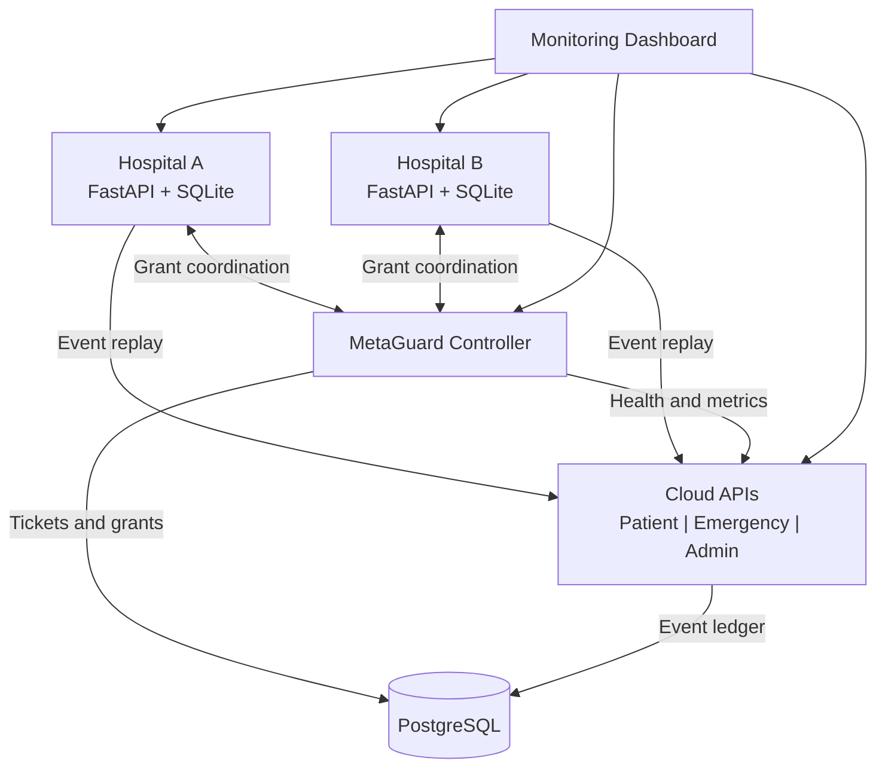

# CrisisGuard

**Dependency-Aware Recovery for Partition-Tolerant Edge-Cloud Systems**

CSC3104 Cloud and Distributed Computing | Singapore Institute of Technology / University of Glasgow | Group 09

## Overview

CrisisGuard is a containerized edge-cloud distributed system prototype designed to maintain event capture during network disruptions and recover pending events safely when connectivity returns.

The system simulates two hospitals that independently record synthetic events. During Cloud outages, each hospital retains its events in a local SQLite database. When connectivity is restored, CrisisMesh and MetaGuard coordinate recovery using dependency-aware scheduling, authenticated replay grants, admission control and idempotent Cloud processing.

CrisisGuard is an academic prototype. It is not intended for clinical deployment. All demonstrations and evaluations use synthetic data.

**Source repository:** https://github.com/Pang-Yong-Kang-Ignatius/Group09_CrisisGuard_CSC3104

## 1. System Architecture



| Component | Responsibility |
|---|---|
| Hospital A and Hospital B | Capture events and persist them locally using SQLite |
| CrisisMesh scheduler | Enforce prerequisite ordering, priority ageing and inheritance |
| MetaGuard controller | Coordinate replay grants, admission limits, fairness and reconciliation |
| Cloud Patient API | Process patient-related events |
| Cloud Emergency API | Process emergency-related events |
| Cloud Admin API | Process administrative events |
| PostgreSQL | Persist the authoritative event ledger and controller state |
| Monitoring Dashboard | Visualize system health, events, recovery status, scheduling and telemetry |

The recommended local deployment consists of eight Docker services: two hospitals, three Cloud APIs, MetaGuard, PostgreSQL and the Dashboard.

## 2. Key Features

### 2.1 Partition-Tolerant Event Capture

Both hospitals can record events while Cloud connectivity is unavailable. Events are persisted locally rather than discarded.

### 2.2 Dependency-Aware Scheduling

CrisisMesh evaluates event prerequisites before replay. The scheduler supports priorities from 1 (lowest) to 5 (highest), priority inheritance, ageing, retry handling and quarantine.

### 2.3 MetaGuard Recovery Coordination

MetaGuard provides controlled admission and authenticated replay grants to coordinate recovery after connectivity returns.

### 2.4 Idempotent Cloud Processing

Cloud services validate event requests and prevent duplicate submissions of the same event from creating additional applied records.

### 2.5 Monitoring and Observability

The Dashboard provides service health, Cloud Event History, recovery monitoring, telemetry and Scheduler Inspector predictions.

### 2.6 Evaluation Policies

The system supports fixed-rate admission and optional experimental policies, including AIMD and pressure-aware variants. These are evaluation mechanisms, not guarantees of superior performance under every workload.

---

## 3. Prerequisites

The instructions below target **Windows 10/11**.

| Software | Requirement | Purpose |
|---|---|---|
| Python | 3.11, 64-bit | Local scripts, configuration and testing |
| Docker Desktop | Linux containers / WSL2 | Run the distributed services |
| Docker Compose | v2 | Container orchestration |
| PowerShell | Windows PowerShell 5.1 or PowerShell 7 | Installation and verification scripts |
| Node.js | 24 | JavaScript regression tests |
| Git | Optional | Clone the repository |
| Browser | Modern browser | Access the Dashboard |

### 3.1 Install Python 3.11

Open PowerShell:

```powershell
winget install --id Python.Python.3.11 -e
```

Restart PowerShell and verify the installation:

```powershell
py -3.11 --version
```

Expected: Python 3.11.x.

If `winget` is unavailable, install Python 3.11 from https://www.python.org/downloads/.

### 3.2 Install Docker Desktop

Download Docker Desktop:

https://www.docker.com/products/docker-desktop/

Enable the WSL2 backend and ensure Docker Desktop is running with Linux containers.

Verify:

```powershell
docker version
docker compose version
```

Both commands should succeed and Docker should report an available server.

### 3.3 Install Node.js 24 (for JavaScript testing)

Download Node.js from:

https://nodejs.org/

Verify:

```powershell
node --version
npm --version
```

Node.js is not required for ordinary Dashboard operation through Docker.

---

## 4. Download the Source Code

### Option A: Download ZIP (recommended for verification)

1. Open the [CrisisGuard submission repository](https://github.com/Pang-Yong-Kang-Ignatius/Group09_CrisisGuard_CSC3104).
2. Select **Code → Download ZIP**.
3. Extract it into a local folder.
4. Open PowerShell inside the extracted project folder.

Avoid extracting into a folder containing an existing CrisisGuard deployment.

### Option B: Clone with Git

```powershell
git clone https://github.com/Pang-Yong-Kang-Ignatius/Group09_CrisisGuard_CSC3104.git
cd Group09_CrisisGuard_CSC3104
```

Both methods provide the application source and deployment scripts.

---

## 5. Python Environment Setup

Run all commands from the CrisisGuard project root, which contains `compose.yaml`, `requirements.txt` and `start.project.bat`.

### 5.1 Create a virtual environment

```powershell
py -3.11 -m venv .venv311
```

### 5.2 Install application dependencies

```powershell
.\.venv311\Scripts\python.exe -m pip install -r requirements.txt
```

### 5.3 Install testing dependencies

Required for the documented full regression workflow:

```powershell
.\.venv311\Scripts\python.exe -m pip install -r requirements-test.txt
```

`requirements-test.txt` includes `requirements.txt`. The shared runtime file
already declares `httpx`, `fastapi`, `uvicorn[standard]` and `pydantic` for the
host outage agent as well as the Docker services. Docker image installation
installs packages inside the image. Install the requirements into the host
environment too.

### 5.4 Verify the installed environment

Each installation command must finish successfully before continuing. Run
these checks with the same interpreter used by the Windows launchers.

```powershell
.\.venv311\Scripts\python.exe -c "import sys; print(sys.executable); print(sys.version)"
.\.venv311\Scripts\python.exe -m pip check
.\.venv311\Scripts\python.exe -c "import httpx, fastapi, uvicorn; from pydantic import BaseModel, ConfigDict; from infrastructure.scripts import local_outage_agent; print('Host imports OK')"
```

`pip check` should report `No broken requirements found`. The import check must
print `Host imports OK`. `pip check` validates installed package metadata. The
import check also verifies the host agent's runtime dependencies.

Both `start.project.bat` and `test.project.ps1` require the repository-local
Python 3.11 environment `.venv311`. The startup launcher checks the host imports
before configuration or Docker operations and reports the selected interpreter
and requirements-based repair commands on dependency failure. Dependencies are
installed explicitly during setup. Repeat startup runs only the preflight check.
If a check fails, rerun the requirements installation using the explicit
`.venv311` interpreter shown above. Preserve any existing environment when
diagnosing an incorrect Python version.

Activation is optional. All commands above use the virtual environment's Python interpreter directly.

If activation is preferred, run:

```powershell
Set-ExecutionPolicy -Scope Process -ExecutionPolicy RemoteSigned
.\.venv311\Scripts\Activate.ps1
```

Use PowerShell, not Command Prompt, for `Activate.ps1`.

---

## 6. Initialize Local Configuration

Create the local environment configuration:

```powershell
.\.venv311\Scripts\python.exe -m infrastructure.scripts.init_local_env --with-local-test-traffic
```

Open the generated environment file:

```powershell
notepad .env
```

Before initializing a fresh PostgreSQL database, replace the example `POSTGRES_PASSWORD` with a private password.

The initializer creates missing local credentials and preserves existing valid settings. Changing `POSTGRES_PASSWORD` after PostgreSQL has initialized does not automatically rotate the existing database password.

**Security:** Never commit `.env`, access tokens, private keys or real patient records.

---

## 7. Start CrisisGuard

Ensure Docker Desktop is running and its Linux engine is available.

From the project root:

```powershell
.\start.project.bat
```

The standard launcher:

1. Checks the repository-local Python 3.11 environment, host imports and local Docker Desktop endpoint.
2. Initializes missing local authentication/telemetry tokens while preserving valid existing settings.
3. Validates the base Compose configuration with the MetaGuard and local test-traffic overlays, plus `compose.override.yaml` if present.
4. Builds and starts all eight services in `crisisguard-local`, waiting for container health.
5. Attempts to export both hospital SQLite snapshots to `db-snapshots`; an export failure prints a warning and leaves the services running.
6. Opens the local outage-agent terminal and the Dashboard in your browser.

The launcher's `--verify` mode skips the agent and browser. It is intended for the separate launcher verifier described in the [Docker guide](docs/DOCKER.md), not as an isolated replacement for ordinary startup.

### Service Addresses

| Service | Local URL |
|---|---|
| Monitoring Dashboard | http://localhost:8080 |
| Hospital A | http://localhost:8000/docs |
| Hospital B | http://localhost:8002/docs |
| Patient API | http://localhost:8001/docs |
| Emergency API | http://localhost:8003/docs |
| Admin API | http://localhost:8004/docs |
| MetaGuard health | http://localhost:8005/health |

### Verify Docker Status

```powershell
docker ps --filter "label=com.docker.compose.project=crisisguard-local"
```

The intended local system consists of eight services.

The launcher uses the persistent Docker Compose project `crisisguard-local`. Starting another checkout with the same project name may reuse or conflict with existing resources. For an independent fresh test, use a clean environment and follow the [Docker guide](docs/DOCKER.md).

---

## 8. Demonstrating CrisisGuard

The Dashboard supports the following typical recovery demonstration.

### Step 1: Confirm Service Health

Open http://localhost:8080 and verify that Hospital A, Hospital B, the Cloud APIs and MetaGuard are healthy.

### Step 2: Authorize Local Outage Controls

Use the **CrisisGuard Cloud Outage Agent** terminal opened by `start.project.bat`. Copy its temporary token into the Dashboard's local outage controls.

Manually launch the agent only if the launcher did not start it, or the previous agent has stopped. Ensure no outage agent is already running on port 8765, then run this from another PowerShell window in the project root:

```powershell
.\.venv311\Scripts\python.exe -m infrastructure.scripts.local_outage_agent --allow-local-demo
```

A manually started agent prints a new temporary authorization token; enter that token in the Dashboard's local outage controls.

The agent operates only on the verified local Docker project. If the containers belong to a different checkout, it deliberately refuses to proceed.

### Step 3: Simulate Cloud Unavailability

Use the authorized Dashboard controls to simulate a local Cloud API outage.

### Step 4: Capture Synthetic Events

Submit unique synthetic events through the Dashboard and confirm that they remain persisted at the hospital edge sites.

### Step 5: Restore Cloud Connectivity

Restore the Cloud APIs and observe MetaGuard-controlled recovery and dependency-aware replay.

### Step 6: Verify Application

Inspect Cloud Event History to confirm that the relevant events were applied and their prerequisites were satisfied.

Do not interpret an empty replayable queue as proof that every event was successfully applied, since quarantined events may still exist.

Restore Cloud availability before closing the outage agent.

For the complete lecturer walkthrough, refer to the separately supplied **`GROUP09_INSTRUCTIONS.pdf`**.

---

## 9. Automated Verification

CrisisGuard includes regression tests and real-system Docker end-to-end tests.

### 9.1 Quick Regression

```powershell
.\test.project.ps1 -Quick
```

### 9.2 Full Regression

```powershell
.\test.project.ps1 -Full
```

Quick and Full cover the same regression test population. Full additionally processes the supported coverage and report outputs.

### 9.3 Real-System End-to-End Verification

```powershell
.\test.project.ps1 -EndToEnd
```

This runs an isolated Docker verification workflow covering real application services, persistence, scheduling, MetaGuard coordination and failure recovery.

**Important:** End-to-end verification may perform controlled fault operations and cleanup. Review the generated isolation manifest and follow the confirmation instructions before authorizing these operations.

Refer to [docs/testing.md](docs/testing.md) for safety restrictions and detailed execution steps.

### 9.4 Recorded Verification Results

The retained [Full regression report](docs/evidence/PROJECT_TEST_COVERAGE.md) records a **7 November 2026** run at source revision `5c2a6acaae9aa20123f769872e164d5580f38cbd` (Python 3.11.9, Node 24.22.1, Windows). The following statuses and totals belong to that historical run; they do not verify the current submission revision:

| Verification | Result |
|---|---|
| Source revision | PASS |
| Python unit tests | PASS |
| API contract checks | PASS |
| Security regression | PASS |
| Python coverage | PASS |
| JavaScript unit tests | PASS |
| Evaluation evidence | PASS |
| Coverage audit generation | PASS |
| JavaScript coverage | NOT VERIFIED |
| PostgreSQL integration | SKIP |
| Docker health | SKIP |
| Proposal acceptance | NOT VERIFIED |

**Regression totals:** 1,542 Python tests and 94 JavaScript tests passed in the recorded verification workflow.

A separate [5 November 2026 isolated Docker E2E run](docs/evidence/PROJECT_VERIFICATION_20261105.md) completed 18 executable checks successfully, including event capture, Cloud application, MetaGuard coordination, recovery scenarios and owned-resource cleanup. Browser interaction/accessibility, complete per-event Cloud log correlation and full performance acceptance were not verified by that run.

These results are scoped to their respective recorded runs. They do not independently establish that the current submission revision, every new checkout, browser, Docker host or AWS environment has been tested. Check [GitHub Actions](https://github.com/Pang-Yong-Kang-Ignatius/Group09_CrisisGuard_CSC3104/actions) for the exact submitted commit; current Windows Full regression results require their own retained execution report.

---

## 10. Troubleshooting

### Python 3.11 Not Found

Check:

```powershell
py -0p
```

If Python 3.11 is not listed, install it using the instructions in Section 3.

### Missing Python Modules

For errors such as:

```text
ModuleNotFoundError: No module named 'httpx'
ModuleNotFoundError: No module named 'fastapi'
```

Install the project dependencies into the virtual environment:

```powershell
.\.venv311\Scripts\python.exe -m pip install -r requirements.txt
```

Run local Python commands using this interpreter rather than an unrelated system Python installation.

### PowerShell `Get-FileHash` Not Recognized

On some Windows setups, a Python subprocess that launches Windows PowerShell 5.1 may inherit module paths from PowerShell 7.

This can cause the AWS packaging regression test to fail even though `Get-FileHash` works when run directly in PowerShell.

If the test `test_powershell_package_command_accepts_zip_without_git` reports that `Get-FileHash` is unavailable, run:

```powershell
$env:PSModulePath = @(
    "$env:USERPROFILE\Documents\WindowsPowerShell\Modules"
    "$env:ProgramFiles\WindowsPowerShell\Modules"
    "$env:WINDIR\System32\WindowsPowerShell\v1.0\Modules"
) -join ';'

$env:PSModuleAutoLoadingPreference = "All"

.\test.project.ps1 -Full
```

This modifies the module search path for the current terminal session only.

### Docker Network Not Found

If Docker reports that an existing container references a missing network, inspect the affected containers and Compose configuration.

Avoid removing unrelated Docker projects. The [Docker guide](docs/DOCKER.md) documents local project ownership and safe shutdown.

### MetaGuard Controller Not Running

The controller is configured through an additional Compose configuration file. Use the project's documented launcher and Compose configuration instead of assuming that `compose.yaml` alone starts every component.

### GitHub ZIP Does Not Contain Git History

Downloading a repository as a ZIP does not include its `.git` directory.

The application and its local verification workflows are designed to support source ZIP delivery, although checks that specifically require Git metadata may report different results.

### Other Problems

Refer to the detailed [testing guide](docs/testing.md), [configuration guide](docs/CONFIGURATION.md) and [Docker guide](docs/DOCKER.md).

---

## 11. Evaluation Summary

CrisisGuard evaluates dependency-aware recovery, admission control, scheduling, network partitions, retries and controller coordination.

Recorded experiments include scheduling comparisons, stress tests, AIMD variants and recovery fault campaigns.

Some experiments achieved correct functional recovery while failing performance or acceptance targets. In particular, AIMD and bounded scheduling were not universally superior under every evaluated workload.

The project does not claim production readiness, unconditional starvation freedom, universal overload protection or suitability for clinical deployment.

Detailed results, methodology, adverse findings and limitations are retained in:

- [Evaluation overview](docs/EVALUATION.md)
- [Submission evaluation](docs/archive/evaluation/CP8_SUBMISSION_EVALUATION_20261101.md)
- [H5/W5 review](docs/reports/H5_W5_REVIEW_20261103.md)
- [Evidence index](docs/EVIDENCE_INDEX.md)

---

## 12. Optional AWS Academy Deployment

CrisisGuard includes an optional three-host AWS Academy Learner Lab deployment workflow.

The AWS launcher supports deployment from a source ZIP without requiring Git history.

Refer to:

- [AWS launcher guide](docs/runbooks/AWS_LAUNCHER.md)
- [AWS infrastructure guide](infrastructure/aws/README.md)
- [Historical AWS outage report](docs/reports/AWS_OUTAGE_TEST.md)
- [MetaGuard recovery evidence](docs/evidence/AWS_METAGUARD_COLLISION_RECOVERY_20261106_completed.md)

Historical AWS experiments were performed using particular earlier source revisions and infrastructure configurations. They should not be interpreted as fresh AWS verification of the current submission repository.

Use only your own authorized AWS Academy Learner Lab account and credentials.

---

## 13. Project Documentation

| Document | Description |
|---|---|
| [Docker guide](docs/DOCKER.md) | Local deployment, persistent storage and shutdown |
| [Dashboard guide](docs/DASHBOARD.md) | Dashboard controls and their verification limits |
| [Testing guide](docs/testing.md) | Regression and E2E verification procedures |
| [Cloud API contract](docs/CLOUD_API_CONTRACT.md) | Event schemas and HTTP API contracts |
| [Configuration guide](docs/CONFIGURATION.md) | Local and deployment configuration |
| [Evidence index](docs/EVIDENCE_INDEX.md) | Experiment records and verification limitations |
| `GROUP09_INSTRUCTIONS.pdf` | Lecturer verification walkthrough, submitted separately |

---

## 14. Team Contributions

| Team member | Primary contribution |
|---|---|
| Pang Yong Kang Ignatius | Cloud APIs, PostgreSQL, Dashboard, integration and documentation |
| Toh Weijun Wayne | MetaGuard controller, admission control and grants |
| Afiq Danial | Hospital edge capture, SQLite persistence and recovery |
| Bettina Ang Wen Xin | Dependency scheduling, priority ageing and inheritance |
| Wong Tze Xuan | Docker, AWS infrastructure, deployment and CI |
| Muhammad Haris Zufayri Bin Shahar | Workload generation, experiments and evaluation |

---

## 15. Academic and Security Notice

CrisisGuard was developed for the CSC3104 Cloud and Distributed Computing coursework project.

The system is intended for academic demonstration and evaluation only.

All patient, emergency and administrative events used in demonstrations must be synthetic. Do not expose private credentials, authentication tokens, SSH keys, database passwords or other confidential infrastructure information.

**CSC3104 | Group 09 | CrisisGuard Final Submission**