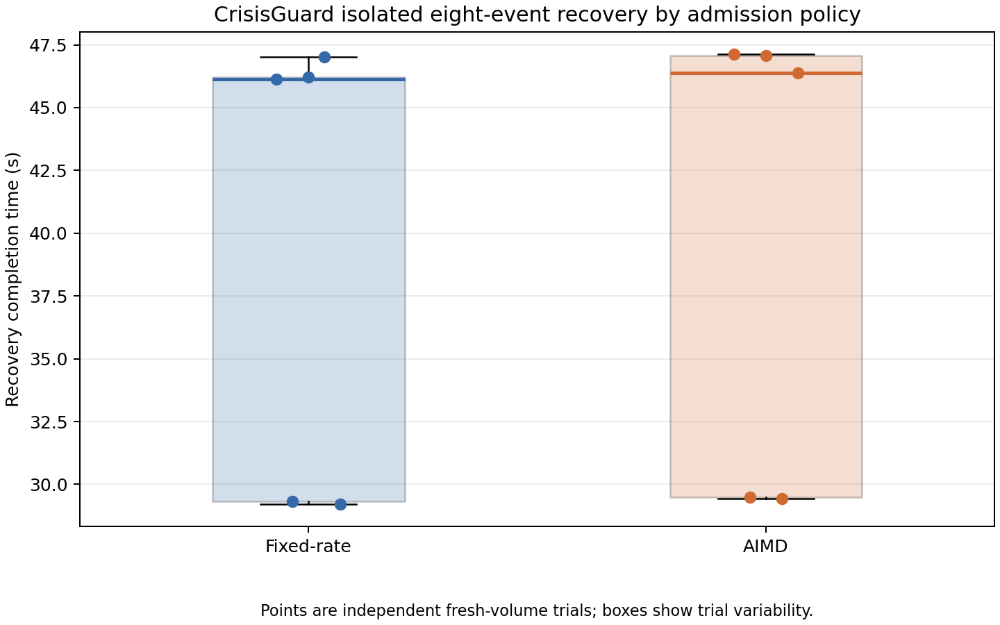
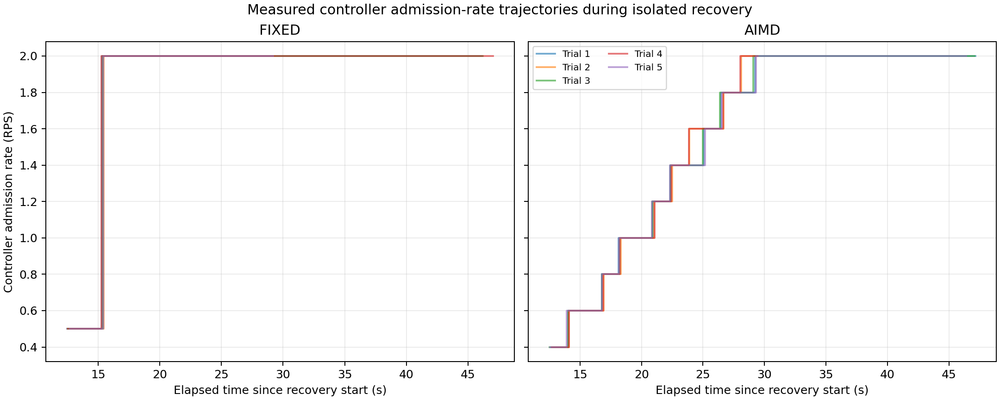
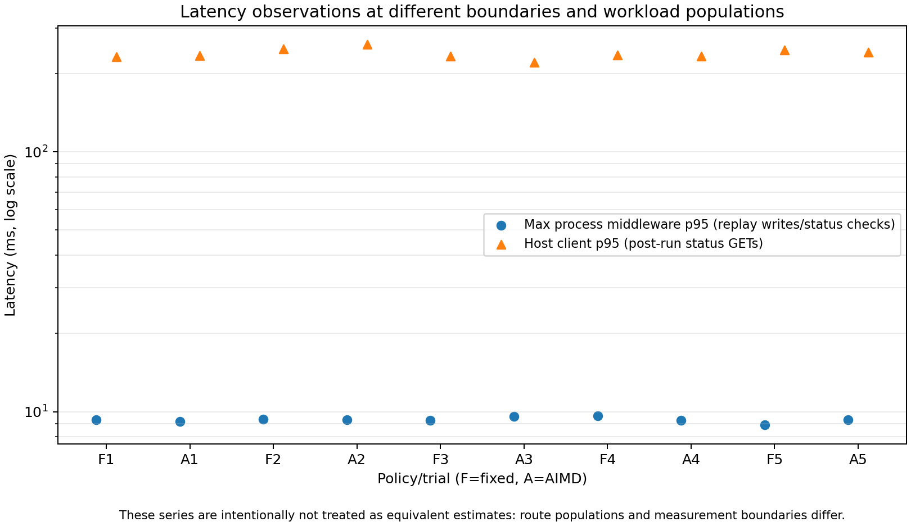
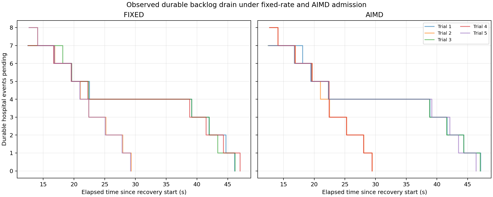

# Checkpoint 7B: Fixed-rate versus AIMD evaluation

**Date:** 29 October 2026  
**Result:** Complete for the bounded isolated recovery comparison; neither policy was shown to be faster.  
**Environment:** Ten disposable Docker Compose projects on the original desktop host. The original stack was inventoried but was never started, stopped, recreated, or addressed by an experiment Compose command.

## Method

Five fixed-rate and five AIMD trials ran in interleaved order. Every trial used a new PostgreSQL volume, new Hospital A/B SQLite volumes, private generated credentials, unique loopback ports, and the same uniquely built application image. Only `CONTROLLER_ADMISSION_POLICY` differed.

Each hospital captured the same four-event dependency chain while automatic replay, the controller, and all Cloud APIs were absent. The eight-event backlog used the same types, priorities, prerequisites, Cloud capacity, controller thresholds, and fault/recovery sequence. At recovery time zero, the controller, Patient, Emergency, Admin, and both hospitals started together with automatic replay enabled.

The controller configuration was Normal/Caution/Recovery = 2.0/0.5/0.2 RPS, inflight limits = 4/2/1, 1-second polls, 5-second freshness, 3-second dwell, two healthy samples, and AIMD additive increase = 0.2 RPS. The experiment made no application or threshold changes.

Measurements included durable backlog drain, controller rate/state/counters, per-service Cloud middleware latency/throughput/errors/sample counts, process-local executor waiting, Hospital transmission retry counters, PostgreSQL application times, grant audit records, and one post-recovery client status read per event. Middleware and client latency are deliberately reported as different populations and measurement boundaries.

## Results

| Measure | Fixed-rate | AIMD |
|---|---:|---:|
| Recovery time, mean ± sample SD | 39.573 ± 9.421 s | 39.898 ± 9.539 s |
| Recovery time, median | 46.128 s | 46.383 s |
| Recovery time, range | 29.210–47.012 s | 29.433–47.131 s |
| Maximum per-service middleware p95, trial mean | 9.290 ms | 9.318 ms |
| Sum of three process throughput readings, trial mean | 0.2319 RPS | 0.2300 RPS |
| Weighted Cloud 5xx rate | 0 | 0 |
| Hospital transmission retries, trial mean | 11.6 | 11.6 |
| Controller allowed decisions, every trial | 16 | 16 |
| Controller denied decisions, trial mean | 11.6 | 11.6 |
| Client status-read p95, trial mean | 239.569 ms | 237.860 ms |
| Maximum executor queue depth/pressure | 0 / 0 | 0 / 0 |
| PostgreSQL events/completed grants, every trial | 8 / 8 | 8 / 8 |

The mean AIMD-minus-fixed recovery difference was **+0.325 seconds**. Its deterministic 20,000-resample bootstrap 95% interval was **−10.130 to +10.776 seconds**; the two-sided exact permutation p-value was **0.579**. The predeclared interpretation rule required both p < 0.05 and an interval excluding zero, so the difference is **not statistically meaningful**. Cliff's delta was 0.44, but with five trials per group, the broad interval and non-significant exact test do not support a policy advantage.

The same exact-test/bootstrap rule found no statistically meaningful policy difference for middleware p95 (p=0.937), summed process throughput (p=0.556), client status-read p95 (p=0.794), site completion gap (p=0.921), retries/denials (p=1.000), Cloud errors (p=1.000), or executor waiting (p=1.000). Full differences and intervals are retained in the statistics JSON.

All ten trials applied the same eight eligible IDs exactly once, retained dependency order, completed eight grants, left no controller tickets, and showed no Cloud 5xx responses. Hospital A and B each completed four events in every trial. Site completion gaps were variable (fixed mean 17.738 s; AIMD mean 17.805 s); across the five trials, the later-finishing site alternated 2/3 under fixed and 3/2 under AIMD. This short experiment is not a long-term fairness result.

Fixed-rate samples moved from measured Caution at 0.5 RPS directly to Normal at 2.0 RPS at about 15.3 seconds. AIMD samples moved from Caution at 0.4 RPS through measured 0.2-RPS additive steps, reaching 2.0 RPS around 28–31 seconds. The initial Recovery interval occurred during container readiness waiting, before host sampling began; only timestamped Caution-to-Normal observations are plotted. AIMD therefore provided a gradual measured ramp, while fixed-rate restored the configured Normal rate sooner, but neither behavior changed recovery time meaningfully in this workload.

## Figures

**Figure 1.** Fresh-volume recovery completion by admission policy. Points are independent trials; the bimodal spread reflects controller poll/start and hospital scheduling alignment. The distributions overlap substantially.

**Figure 2.** Actual timestamped admission-rate observations. Fixed-rate changes with controller state; AIMD increases in 0.2-RPS steps. No unobserved initial Recovery timestamp is invented.

**Figure 3.** The maximum process-local Cloud middleware p95 and host-observed post-run status-read p95. These are different routes, populations, and boundaries and must not be treated as equivalent latency estimates.

**Figure 4.** Timestamped durable Hospital A/B pending-event totals. Flat intervals are measured queue persistence, not interpolation. Executor wait depth remained zero, so this experiment did not calibrate saturated executor pressure.

## Interpretation

The bounded experiment found no recovery-time, middleware-latency, throughput, error, retry, or short-run completion-distribution advantage for either policy. AIMD's measured advantage is behavioral: its recovery ramp is gradual rather than a state-triggered jump. Its corresponding disadvantage is slower restoration of the configured 2 RPS ceiling. Fixed-rate reaches Normal capacity earlier but does not provide the same incremental ramp. Under this small backlog and healthy post-start Cloud, neither distinction produced a statistically meaningful completion-time change.

This result supports completing the proposal's controlled fixed-versus-AIMD comparison, not a general claim that the policies are equivalent. The experiment used one desktop, five trials per group, eight events, a cold Cloud/controller outage followed by healthy recovery, and no executor saturation. Fixed preceded AIMD within each interleaved pair rather than using randomized order; fresh resources reduce carry-over, but temporal order remains a possible confounder. Its throughput values are sums of three independent process-local rolling-window estimates, not a single aggregate throughput counter. Client status-read latency includes host/Docker/network overhead and a different route population. Socket, upstream, and PostgreSQL queues were not measured. The small sample and bimodal timing make the uncertainty interval broad.

Long-term Hospital A/B fairness, AWS adaptive transitions, and adoption/calibration of live-only p95 or executor-pressure signals remain separate unchecked Checkpoint 7B work.

## Evidence and reproduction

- [Raw trial evidence](../evidence/cp7b-fixed-vs-aimd-raw-final-20261029.json)
- [Trial summary CSV](../evidence/cp7b-fixed-vs-aimd-summary-20261029.csv)
- [Timestamped measurements CSV](../evidence/cp7b-fixed-vs-aimd-timeseries-20261029.csv)
- [Statistical results and transitions](../evidence/cp7b-fixed-vs-aimd-statistics-20261029.json)
- [Experiment runner](../evidence/cp7b-fixed-vs-aimd-experiment-20261029.py)
- [Analysis and graph generator](../evidence/cp7b-fixed-vs-aimd-analysis-20261029.py)
- [Focused regression JUnit](../evidence/cp7b-fixed-vs-aimd-focused-tests-20261029.xml): 118 passed, zero failures/errors, one deprecation warning
- [First harness attempt](../evidence/cp7b-fixed-vs-aimd-raw-20261029.json): one successful fixed trial followed by a cleanup assertion caused by a retained Compose profile marker; the exact disposable leftover was removed, cleanup was corrected, and all final trials used new projects

Two restricted-shell attempts to run the focused tests reached temporary-directory permission errors (including pytest's own session-cleanup failure); they did not report assertion failures and are not counted as passes. The same selection was rerun once outside that filesystem restriction and produced the preserved 118-pass JUnit result.

The final run preserved all 33 pre-existing container identities/images/mounts and all 16 pre-existing volumes. Its ten disposable projects removed their containers, networks, and volumes. The final and first-attempt uniquely tagged evaluation images were retained; no policy-comparison container, volume, or network remains. No original database was mounted or queried.
