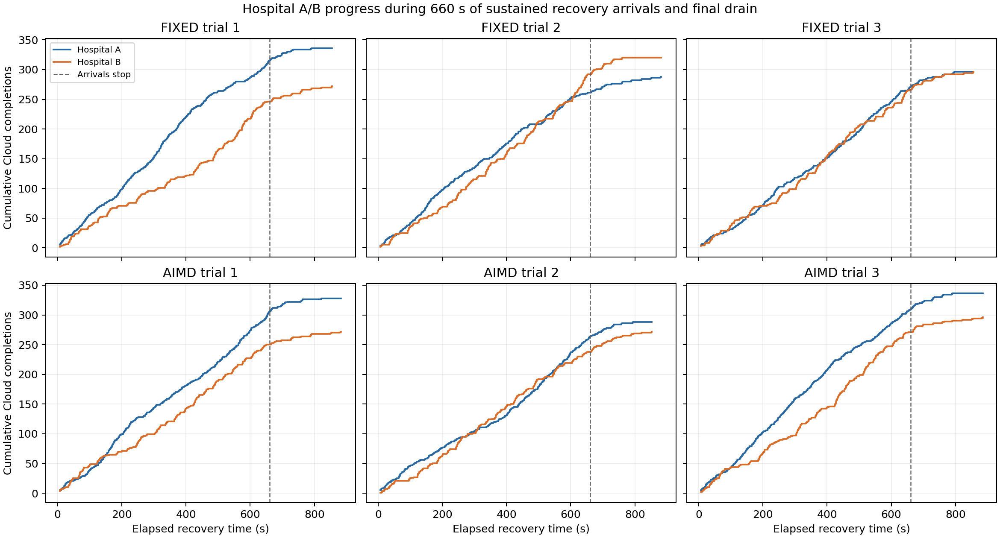
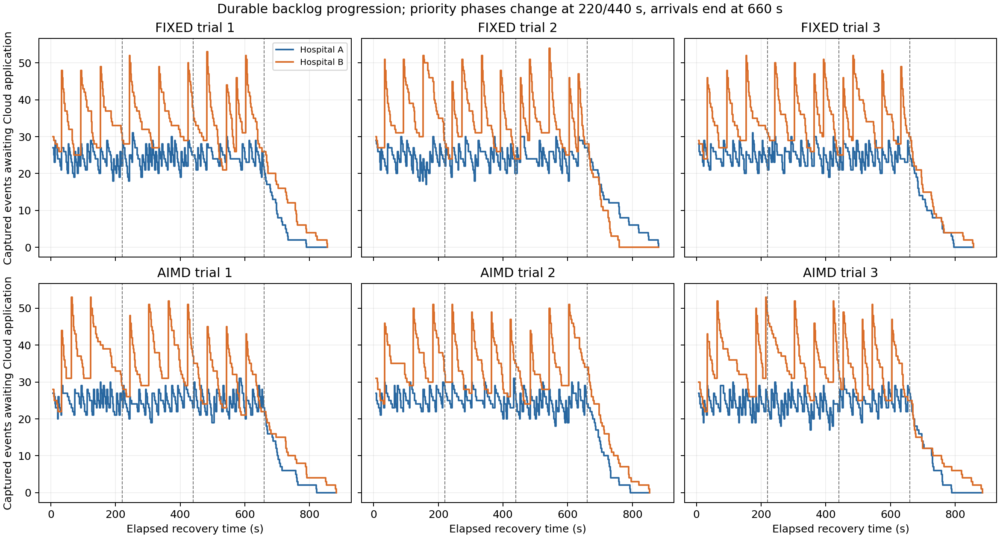
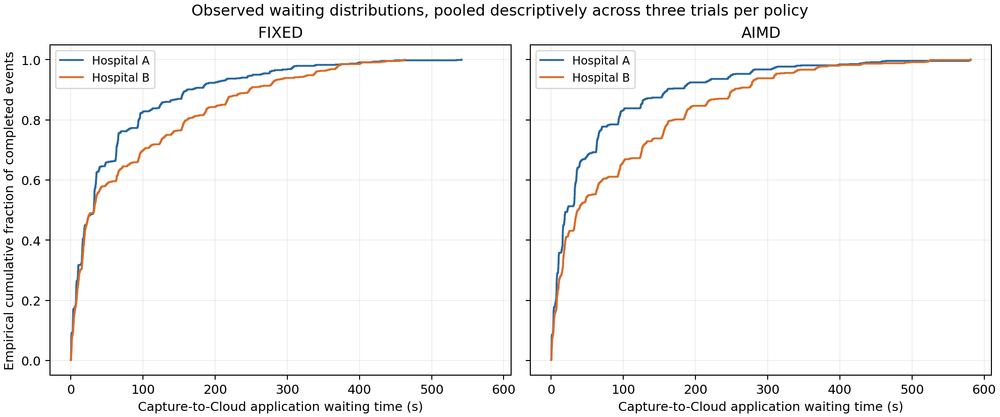
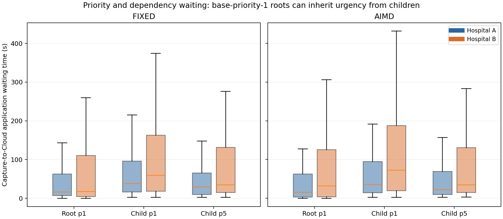

# Checkpoint 7B: sustained Hospital A/B fairness

Date: 29 October 2026. This report evaluates finite sustained recovery, with conclusions limited to the measured workload and duration.

**Result: completed sustained-run verification.** All six trials passed, both hospitals progressed throughout the measured arrival windows, and all 3,600 events finished without loss, duplication or dependency-order violations. Finite evidence does not establish indefinite fairness or a maximum elapsed waiting guarantee.

## Results and variability

Each policy has three fresh-project replicates. Rates cover exactly the first 660 seconds of replay; waiting times include all captured events, including the final drain. Values marked ± are the mean and sample standard deviation across the three trial summaries. The p95 column averages each trial's exact nearest-rank p95, rather than treating pooled events as independent trials.

| Policy / hospital | Sustained completion rate, events/s | Mean capture-to-Cloud wait, s | Trial p95 wait, s | Longest event wait, s | Longest sustained completion gap, s |
|---|---:|---:|---:|---:|---:|
| Fixed / A | 0.4283 ± 0.0432 | 60.863 ± 7.039 | 256.340 ± 33.439 | 541.563 | 32.719 |
| Fixed / B | 0.4061 ± 0.0349 | 85.127 ± 7.138 | 328.024 ± 44.268 | 462.599 | 26.356 |
| AIMD / A | 0.4449 ± 0.0390 | 59.677 ± 5.638 | 248.449 ± 29.844 | 581.383 | 19.562 |
| AIMD / B | 0.3833 ± 0.0253 | 92.679 ± 4.224 | 324.623 ± 16.048 | 581.113 | 42.348 |

| Trial | Fixed final A/B completions | AIMD final A/B completions |
|---|---:|---:|
| 1 | 336 / 272 | 328 / 272 |
| 2 | 288 / 320 | 288 / 272 |
| 3 | 296 / 296 | 336 / 296 |

Both hospitals had captured work awaiting Cloud application at **100% of the sampled points during sustained arrivals**. Each of the 132 full hospital-minute intervals contained at least **six completions**, with zero empty completion intervals. All final backlogs were zero. Complete recovery and verification lasted 853.239–885.391 seconds per trial, below the 1,080-second bound.

The controller remained fresh, Normal and at 2 RPS throughout all recorded samples for both policies. The sampled Cloud lifetime 5xx counters remained zero. Thus these runs assess sustained scheduling fairness with the two policies operating at the same healthy admission ceiling; the observed throughput/waiting differences cannot demonstrate an AIMD advantage or disadvantage. Three replicates on a shared host are reported descriptively, without a statistical policy-superiority claim.

### Starvation and controller selections

No hospital stopped progressing for the remainder of a trial, and no event remained unfinished. The maximum individual wait was **581.383 seconds**. A hospital could nevertheless see as many as **25 peer event completions** while it had Cloud-prerequisite-ready work. That measure includes local retry backoff, local acknowledgement and scheduling delays; it does not measure a retained controller ticket being bypassed 25 times.

There were **168 sampled durable-ticket observations traceable to actual allocations**. At most **one other successful allocation** occurred between observing such a ticket and its service; none violated the conditional predecessor-plus-bypass bound. Every retained grant's recorded original bypass count was at most one. These sampled witnesses and the focused regression tests support the controller's selection fairness under the stated assumptions. They do not prove an infinite-horizon elapsed-time completion bound, and the witnesses do not cover tickets appearing and disappearing between polls.

The longest waits are material: sustained hospital progress can coexist with several-minute waits for individual events. This experiment establishes neither a per-event service-level deadline nor an upper bound for arbitrary future workloads. No event waited 600 seconds, and the maximum recorded effective priority was five, so crossing a 600-second run duration did **not** itself validate ageing of an individual event past the scheduler's first ageing interval.

### Priority and dependency delays

The audit records **917 base-priority-1 roots allocated at effective priority five**, consistent with urgent-child inheritance. All children were applied after their prerequisites. Across pooled events, low-priority children waited longer on average than urgent children, but urgency did not improve every tail percentile:

| Policy / hospital | Priority-1 child mean / p95 wait, s | Priority-5 child mean / p95 wait, s |
|---|---:|---:|
| Fixed / A | 76.694 / 282.366 | 56.971 / 210.469 |
| Fixed / B | 108.087 / 358.196 | 83.294 / 276.441 |
| AIMD / A | 69.556 / 251.628 | 63.128 / 278.963 |
| AIMD / B | 124.936 / 382.253 | 80.448 / 254.336 |

These pooled strata are descriptive. Arrival timing, phase, retry history and dependency blocking differ; the table is not a causal inheritance ON/OFF comparison. Hospital B's larger bursts also produce longer waits than Hospital A's smaller steady replenishment. The design deliberately tests both patterns, but does not isolate hospital identity from arrival pattern.

## Figures



**Figure 1.** Actual sampled cumulative PostgreSQL applications in each trial, using shared scales. Both hospitals continue progressing; the dashed line marks the end of sustained arrivals at 660 seconds. Final totals differ because the same bounded replenishment rule responds to each trial's observed backlog.



**Figure 2.** Captured events awaiting Cloud application, using shared scales. The steady and burst arrival patterns remain visibly distinct. Vertical lines show priority-phase changes at 220/440 seconds and arrival cutoff at 660 seconds; all queues subsequently drain.



**Figure 3.** Empirical capture-to-Cloud waiting distributions, including the complete observed tails and all final-drain events. Events are pooled only for descriptive display; experimental replication is at the project/trial level.



**Figure 4.** Waiting by hospital, policy, dependency role and base priority. Boxes show the median and interquartile range; whiskers follow the 1.5-IQR convention. Individual outlier points are omitted here; all values and maxima remain visible in the waiting distribution figure and event CSV. Base-priority-1 roots may inherit urgency from priority-5 children.

## Method

Three independent disposable Docker projects per admission policy use the unchanged real Hospital A/B capture, automatic replay, dependency scheduler, authenticated controller grants, and all three Cloud APIs. The runner reuses Compose isolation, port allocation, inventory and cleanup from the preceding fixed-rate/AIMD experiment. Application sources in the uniquely built image are checked against SHA-256 hashes of the working-tree Python sources.

Every project captures 32 events per hospital while replay and Cloud are absent. Cloud is restored and the controller reaches fresh Normal state at 2 RPS before replay starts. This common starting condition removes cold-start admission ramp differences from the scheduling fairness experiment. The earlier fixed-rate/AIMD report covers cold-start ramp behavior.

Each trial then receives 660 seconds of sustained, backlog-dependent arrivals, followed by at most 420 seconds to drain. Hospital A checks every 10 seconds and adds eight events when fewer than 24 captured events await Cloud application. Hospital B checks every 30 seconds and adds a burst of 24 when fewer than 32 await Cloud application. These identical replenishment rules keep workloads bounded and comparable across policies; actual event totals can differ because replenishment responds to observed completions. Equal completion shares are therefore not an imposed acceptance condition.

The first 220 seconds favor Hospital A with priority-5 children while Hospital B's children have priority 1. The second 220 seconds reverse those priorities. The final 220 seconds mix both. Each two-event dependency chain has a base-priority-1 Patient registration root and an Emergency or Admin child. Urgent children lend priority to their roots through the existing inheritance algorithm. Initial and later events retain their original priorities after phase changes.

The controller's test-local configuration is identical to the previous comparison: Normal/Caution/Recovery rates 2/0.5/0.2 RPS, inflight limits 4/2/1, poll 1 second, freshness 5 seconds, dwell 3 seconds, two healthy samples, AIMD additive increase 0.2 RPS, caution/healthy latency thresholds 80/50 ms, and recovery error fraction 0.15. Production configuration and application code are unchanged.

All six projects run concurrently on the same host, measured as 16 Docker CPUs and about 31 GiB of Docker memory. This shares host variability between policies but does not provide independent-host replication. Rates and waits are summarized across three trials per policy; pooled event distributions are descriptive, not independent experimental replicates.

## Measurement definitions

- Completion rate: actual PostgreSQL applications per hospital during the 660-second arrival interval, divided by 660 seconds.
- Capture-to-Cloud waiting: PostgreSQL application timestamp minus the hospital's durable SQLite creation timestamp. It includes initial staging, dependency blocking, local scheduling, retry backoff, grant waiting and transport/application time.
- Prerequisite blocking: time from capture until the last prerequisite is applied in Cloud. The subsequent waiting measure still includes local acknowledgement delay and retry backoff; it is not an exact measure of local scheduler eligibility.
- Backlog: captured IDs absent from PostgreSQL, sampled about every two seconds. Final local acknowledgements and SQLite integrity are checked separately.
- Controller selection fairness: sampled durable queue positions are followed to actual allocation audit rows; recorded bypass counts and successful intervening selections are assessed separately from elapsed waiting.
- Finite starvation evidence: unfinished events, maximum waiting, completion gaps, and peer completions while a hospital has Cloud-prerequisite-ready work. These cannot establish an infinite-horizon guarantee.

The scheduler's documented selection bound is `p + B + 1` successful selections for a retained waiting ticket with `p` predecessors and bypass limit `B`, assuming tail-only arrivals, continued successful selections, and no external ticket removal/reset. With two hospitals and B=1, that is at most three selections. It bounds controller selection, not elapsed time or completed replay. Unavailable telemetry, unresolved grants, failed dependencies, retry backoff and absent caller activity fall outside a wall-clock fairness guarantee.

## Tests, integrity and preservation

- **128 focused unit cases passed**, zero failures/errors/skips; one dependency deprecation warning. Selection covered the controller scheduler, local scheduler, priorities, replay candidate rules, grant replay and admission.
- **Seven focused real-PostgreSQL cases passed**, zero failures/errors/skips, in temporary schemas inside a disposable trial database. They cover waiting-ticket replacement, bounded bypass, idempotent grant acknowledgement, admission-denial fairness, sustained priority imbalance, concurrent identical writes and out-of-order application handling.
- **Six sustained trials passed**: exact PostgreSQL/SQLite ID sets and contents, prerequisite order, one completed grant per event, no remaining tickets, no quarantined/in-flight events, and SQLite `PRAGMA integrity_check = ok`.
- **48 completed-grant duplicate POST probes** returned the required HTTP 409 and did not add events. Concurrent idempotent application under an acknowledged grant is covered by the PostgreSQL tests.
- All **33 original container identities/images/mounts and the exact 16-volume set** were preserved; application source hashes were unchanged. Original databases were never mounted or queried. All six final disposable projects removed their containers, networks and volumes; uniquely tagged evaluation images were retained.

No production application, scheduling rule, admission threshold, credential, database or Docker resource was changed. The only TODO update records the completed finite sustained fairness evidence. The full unit suite was not rerun.

## Limits and remaining Checkpoint 7B work

The evidence is substantially longer than the preceding 29–47-second eight-event comparison, with continuous measured contention and hundreds of completions per hospital. It remains six finite, single-host runs of about 14–15 minutes each, not a multi-hour soak or proof against indefinite postponement. Fresh healthy telemetry held both policies at 2 RPS; prolonged telemetry failures, network partitions, unresolved grants, different hospital counts and unbounded offered load were not exercised. Live-priority ageing beyond 600 seconds of individual waiting was not observed.

Backlog samples are spaced about two seconds apart, so rapid ticket changes can be missed. Waiting uses UTC timestamps from databases in the same Docker environment. The raw `host_minus_postgres_clock_seconds` field includes subsequent verification work and is not a calibrated clock-offset measurement; it is not used in waiting calculations.

Remaining 7B work is AWS adaptive transitions; an agreed decision and representative-load validation before adopting live-only p95/executor-pressure signals; further representative calibration before proposal-level signal claims; and Wayne's final component review. No new TODO item is introduced.

## Evidence and reproducibility

- [Experiment runner](../evidence/cp7b-sustained-fairness-experiment-20261029.py)
- [Analysis and figure generator](../evidence/cp7b-sustained-fairness-analysis-20261029.py)
- [Raw measurements](../evidence/cp7b-sustained-fairness-raw-20261029.json)
- [Per-hospital trial summary](../evidence/cp7b-sustained-fairness-summary-20261029.csv)
- [Event measurements](../evidence/cp7b-sustained-fairness-events-20261029.csv)
- [Sampled backlog and completion timeline](../evidence/cp7b-sustained-fairness-timeseries-20261029.csv)
- [Per-minute progress](../evidence/cp7b-sustained-fairness-minute-progress-20261029.csv)
- [Controller ticket witnesses](../evidence/cp7b-sustained-fairness-ticket-witnesses-20261029.csv)
- [Trial variability and audit statistics](../evidence/cp7b-sustained-fairness-statistics-20261029.json)
- [Focused unit JUnit](../evidence/cp7b-sustained-fairness-unit-tests-20261029.xml)
- [Focused PostgreSQL JUnit](../evidence/cp7b-sustained-fairness-postgres-tests-20261029.xml)

Run the experiment with a new output filename to preserve prior evidence:

```powershell
python docs/evidence/cp7b-sustained-fairness-experiment-20261029.py --trials 3 --seconds 660 --drain-seconds 420 --output docs/evidence/NEW-fairness-raw.json
python docs/evidence/cp7b-sustained-fairness-analysis-20261029.py docs/evidence/NEW-fairness-raw.json --outdir docs/evidence
```

The analysis writes fixed dated artifact names; use a separate output directory to preserve an earlier analysis. The experiment requires Docker, Python/httpx/psycopg and capacity for six seven-service projects; graph generation requires matplotlib.

An initial attempt was stopped after source review found an incorrect final duplicate-check expectation. Completed grants are terminal and identical POSTs using them must receive HTTP 409. The corrected harness checks that fence and unchanged event counts; concurrent duplicate writes under an acknowledged grant are tested separately in the focused PostgreSQL regressions. [Interrupted evidence and exact cleanup](../evidence/cp7b-sustained-fairness-interrupted-20261029.json) are retained and excluded from final results. All six interrupted projects were removed under verified labels, preserving 33 pre-existing containers and 16 volumes.
