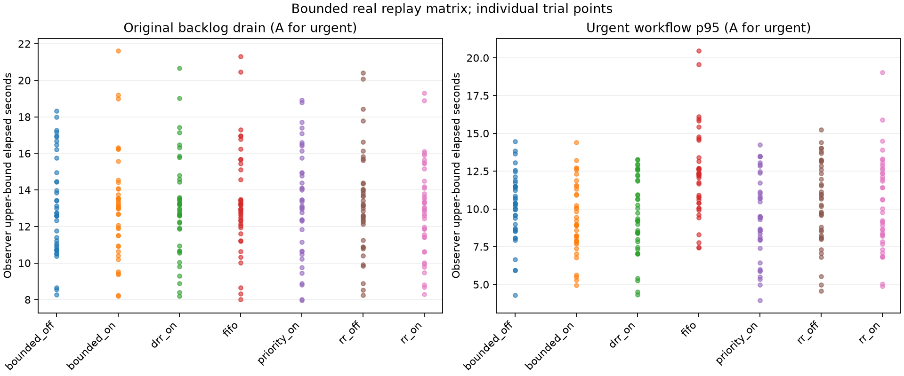
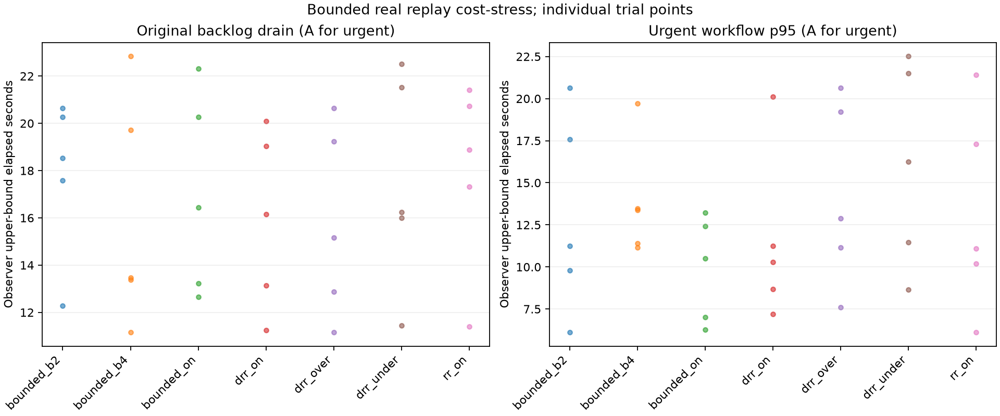

# Haris: checkpoint 8A/8B evaluation, 30 October 2026

Owner: Haris (evaluation). Existing scheduler, controller, edge, Cloud and
deployment work retains its teammate attribution. Reviewed checkout:
`06934d541f25faf769b72acbb5a66602a39f2234`, branch `origin/haris`.
This report distinguishes freshly executed checks, recalculated historical
measurements, and requirements still blocked or not tested.

## 8A: evidence review

The authoritative proposal is `Downloads/Telegram Desktop/GROUP09 (6).pdf`,
SHA-256 `ed4f6d8703aeb86ca2d324d1524c556ab968dd0437b44aefe3cb16a0506e5847`,
matching the original requirements audit. Its D1/D2/D3 specify separate local
inheritance and inter-site scheduling comparisons under common admission,
16 calibrated-load conditions with at least five paired seeds, and explicit
correctness, latency, routine/drain regression and live-SLO targets.

| Proposal claim | Existing evidence reviewed | Remaining gap / allowed conclusion |
|---|---|---|
| Inheritance advances urgent prerequisites | Fresh summary audit: 40 cases, 30/30 eligible urgent dependency pairs improved, zero depth-0 control failures, unresolved events or incomplete pairs | Local selection positions with immediate simulated ACKs and frozen ageing; no elapsed recovery claim |
| Historical evidence provenance | Five retained summary hashes exactly match the five entries of `CrisisGuard-inheritance-matrix01-backup.zip` | Original per-event traces and timing samples are MISSING; summary consistency cannot recover them |
| Routine and computation trade-offs | Three figures regenerated and visually reviewed; routine group means up to 2.34%; CPU ratios roughly 1.2-2, some unavailable | Whiskers are seed min/max, not CIs. Small Windows CPU timings have resolution/zero-denominator exclusions; no precise production efficiency claim |
| Fixed versus adaptive admission | Retained ten-trial raw data recalculates exactly: AIMD minus fixed +0.325 s, bootstrap 95% -10.130 to +10.776 s, exact permutation p=.579 | Five independent projects/group, deterministic fixed-before-AIMD order, eight-event cold start including readiness; no superiority/equivalence claim. `fixed` is state-dependent, not constant-rate |
| Sustained hospital progress | Retained six-trial statistics recalculate exactly: 3,600 events, 660-s arrivals, 132 hospital-minute progress intervals, 168 sampled ticket witnesses, maximum wait 581.383 s | Backlog-responsive arrivals produce unequal totals; not paired identical event streams, indefinite fairness, elapsed wait bounds or an event crossing the 600-s ageing interval |
| Live p95 and actual executor pressure | Recalculated 41,144 reads, 8,737 snapshots, 1,786 offered-arrival cap skips; three replicas/phase with failed preparation attempts and diagnostic supplements retained | Process-local completed-window p95; upstream/server/DB queues partly outside the boundary. Read-heavy, uncalibrated and observe-only |
| AWS adaptive transitions | Recorded passing isolated single-host AWS transition, stale denial, pacing and cleanup evidence reviewed | Not freshly executed; no full three-host recovery-performance claim |
| Supported live writes and SLO | Recorded grant/provenance boundary and blocked Dashboard path match current source and tests | Successful live-classified writes unavailable through grant enforcement. Architecture-owner decision required; no relabelling or weaker authentication |
| Integrated policy comparisons / D3 acceptance | New opt-in baselines, 280-trial screen, automatic pilot, separate service-wall calibration and 35-trial cost stress below | Absolute read RPS, finite backlogs and proxy costs cannot establish the full calibrated proposal matrix or acceptance targets |

Fresh audit evidence is [cp8-review-20261030.json](../../evidence/cp8-review-20261030.json).
Its source-lineage comparison uses Git HEAD blobs and explicitly tests CRLF/LF
normalization rather than calling Windows checkout differences code changes.
Five of seven historical inheritance fingerprints match; scheduler/session
revisions differ. The fairness inventory has 26 matching source files and one
different revision. This is lineage information, not a reexecution claim.
The historical manifest still says `running`; the independently reconciled
completed summary marker and calculations pass. Neither original file was edited.

Statistical units are workload seeds or disposable projects, not requests or
repeated timing calls. Historical fixed/AIMD analysis uses independent-group
bootstrap/permutation rather than an invented seed pairing. Sustained fairness
is descriptive with three replicas/group; pooling its events does not create
3,600 independent trials. Telemetry analysis keeps completed phase lineage and
excludes interrupted phases while retaining their failed raw records. Its cap
skips are offered traffic not attempted at the server, and do not count as
server rejections. CPU figures with zero-duration denominators stay undefined.

Historical fairness analysis subtracts SQLite/Cloud/host UTC timestamps on one
host; its waits depend on clock alignment and PostgreSQL `NOW()` is not an exact
commit timestamp. Fixed/AIMD begins sampling after blocking readiness, so early
transitions and precise early completion intervals cannot be reconstructed.
The new observer below uses one monotonic clock and bounds query uncertainty.

Original raw inheritance backup: `C:\Users\muhdh\Downloads\CrisisGuard-inheritance-matrix01-backup.zip`
(only summaries, SHA-256 recorded in review JSON). No historical traces were
regenerated. New recalculations are ignored under `evaluation/results/cp8-review-20261030`,
`cp8-prior-fixed`, `cp8-prior-fairness` and `cp8-prior-telemetry`.

## 8B: implementation and definitions

The new entry point reuses the 7B runner's Compose resolution, generated
credentials, port allocation, resource inventory and project commands, and the
fairness runner's test settings. It retains the same label/baseline-fenced
cleanup, and the existing generator and six-field `capture_request()` contract.
There is no new deployment framework or dependency. An absent local
`compose.override.yaml` is optional; supplied local overrides still pass through
the existing resolver and isolation assertions.

Experiments require `CRISISGUARD_EXPERIMENTAL_POLICIES=1` for any nondefault
policy. Normal defaults remain inherited local priority and central bounded
priority with B=1. Invalid switches fail before accepting captures/allocations.
Grant authentication, content digests, dependency checks, candidate replacement,
unsent-grant fencing, pinned uncertain attempts, reconciliation and no-blind-resend
remain in the same execution path. Inspector's `inheritance=false` remains a
read-only comparison; it is not an execution switch or the experiment ledger.

| Policy ID | Local selection | Central allocation |
|---|---|---|
| `rr_off`, `rr_on` | Aged priority, inheritance OFF/ON | FIFO ticket order; RR only when continuously eligible hospitals rejoin the tail |
| `bounded_off`, `bounded_on` | Aged priority, inheritance OFF/ON | Highest priority with FIFO ties; B=1 bypass budget |
| `priority_on` | Inherited aged priority | Highest priority, FIFO ties, unrestricted overtaking; no bounded-wait claim |
| `drr_on` | Inherited aged priority | Durable deficit round robin; quantum=1, one estimated unit/event in this screen |
| `fifo` | Oldest dependency-eligible capture, then ID; no priority ranking or inheritance | FIFO tickets |

DRR credit and cursor updates commit atomically with grant allocation under the
existing serialized transaction and roll back on failure. Eligibility withdrawal
discards that site's credit; restart restores committed credit. The implementation
accepts bounded integer event-ID cost estimates in private experiment settings;
variable-cost accounting and rollback have tests. **The main matrix uses unit costs**
and degenerates toward event-count RR while sites remain eligible. The separate
service-wall calibration and expensive-event sensitivity below exercise variable
costs; neither measures CPU demand or establishes sustained cost fairness. Advertised effective priorities are preserved even for local FIFO;
eligibility and dependency safety still apply.

The frozen screening configuration uses 44 events, ratios 1:1/10:1, configured maximum depths 0/3,
balanced/A-only urgency, urgency fraction .5, seeds 3104-3108 and seven policies.
The higher urgency fraction gives the four-event B backlog an urgent workflow
in skewed balanced cases. IDs, contents, graphs and order are identical within
each paired workload; capture timestamps are actual SQLite capture times, not
the generator's frozen historical timestamps. Policy order uses a fixed,
condition/seed-derived randomization independent of outcomes. New volumes,
credentials, ports and project names reset state between trials. At 44 events, balanced maximum-depth-3 cases contain ten depth-3 and two depth-1 workflows because the existing generator truncates the final chain per site; skewed cases contain eleven full depth-3 workflows. Actual depth counts are retained in every workload manifest. The screen
does not replace the original 440-event local study.

All scheduler comparisons use the same opt-in AIMD admission and existing 7B
test thresholds. The full-size screening ceiling is Normal/Caution/Recovery
20/5/2 RPS, additive step 2 RPS, in-flight caps 4/2/1. These are uncalibrated,
test-local parameters frozen after pilot verification; production settings and
observe-only fields are unchanged. This is not another fixed/AIMD study.

The host has 12 Docker CPUs and 8,240,373,760 bytes of Docker memory. Pilot
resource observations guide bounded concurrency; no original service is started,
stopped, mounted, queried or recreated by experiment commands. Experiments
preserve exact baseline container identities/images/mounts and volume sets.

Each hospital uses authenticated manual activation of **the real scheduled
replay function** with grants; AUTO_REPLAY=0. Startup/capture/Cloud readiness are
separate from replay activation to Cloud application. This activation excludes automatic detection. A separate genuine Cloud-outage
pilot below measures automatic reconnection with observer intervals; independent
two-link partitions remain NOT TESTED. Application UTC status is not substituted
for the observer clock.

The one-host observer polls PostgreSQL every .25 s plus actual query and sampling
overhead. Event completion is bounded by the previous query's start and first
positive query's end; observed intervals and actual gaps are retained. These
are application-visibility intervals, not exact commit instants. Local ACK drain
is recorded separately. No cross-host timestamps are subtracted for new elapsed
metrics. Original event/workflow denominators, capture failures, all incomplete
work, quarantines, timeouts and interrupted trials remain visible.

Authenticated live status GETs target a fixed rotating original-ID sequence at
2 offered requests/s, one in-flight client request. Early 404s before that ID is
applied are retained as failures; they are not successful live-write traffic or
an existing-record live SLO workload. Client latency, response/error counts,
cap skips and process middleware populations stay separate from replay and
unclassified traffic. Resource snapshots are sampled Docker CPU%/memory, not
whole-run peaks or scheduler-only CPU attribution.

Before interpreting performance, each completed trial checks original ID set,
exact content, local ACKs, SQLite integrity/recovery state, dependency allocation
and stored application order, one completed grant/event, no active tickets,
and a completed-grant duplicate fence with unchanged event count. Audit/SQL
observations complement existing no-resend tests; ledger uniqueness alone is
not proof of one send.

## Fresh execution and outcomes

All counts here are actual executions. Trials are fresh disposable projects;
the repeated test suites overlap and are not added as unique cases.

| Execution | Observed outcome | Scope |
|---|---|---|
| Initial unit baseline | 832 passed | Before changes |
| Final unit suite | 863 passed, zero failures/skips; one existing Starlette deprecation warning | 31 added policy, analysis and cost tests; final retained JUnit |
| Real PostgreSQL suites | 67 passed per successful full-size pilot | 61 existing + six added selection/restart/rollback/withdrawal cases; repeated runs overlap |
| Small pilot01, 2 RPS | 8/8 events; drain 11.998 to 12.279 s; 66 PG cases | Initial correctness/measurement gate |
| Initial 2-RPS expansion | One 44/44 pass; different-seed trial 43/44 at 180-s timeout; two interrupted snapshots 33/44 and 32/44 | Four original denominators of 44; 152 observed applications, 24 not observed at retained cutoffs. Not a paired ON/OFF result |
| Full-size pilot02 | 44/44; drain 8.677 to 8.953 s | Common AIMD ceiling changed to 20 RPS after the timeout; not pooled with 2-RPS results |
| DRR pilot03 | 44/44; drain 7.900 to 8.180 s; 67 PG cases | Unit cost, separate pilot |
| Main matrix02 | 280/280 trials, 12,320/12,320 event applications | Eight conditions x five seeds x seven policies |
| Automatic auto01 | 44/44 applied; measurement failed because no initial outage/reconnection stamp | Retained failed measurement; no automatic timing claim |
| Automatic auto02 | 44/44 applied and both reconnect intervals observed; harness expected 403 instead of actual disabled-route 404 | Retained failed assertion; application was correct; no result silently relabelled |
| Automatic auto03 | 44/44; drain 24.075 to 24.401 s after Cloud restoration starts; 67 PG cases | Corrected full verification, SQLite/recovery and disabled-manual 404 check pass; n=1 |
| Constant-rate constant01 | 44/44; drain 10.321 to 10.606 s; 67 PG cases | Functional baseline only; n=1, not a performance comparison |
| Separate cost calibration | Three replicas, 315/315 applications | 60 warmup + 240 measured normal + 15 measured heavy events |
| Cost stress01 | 35/35 trials, 1540/1,540 applications | One selected condition, five seeds, B=0/1/2/4 and nominal/under/over DRR costs |

The adverse ledger is [cp8-adverse-20261030.json](../../evidence/cp8-adverse-20261030.json).
It retains original event/workflow denominators, snapshots, errors, known capture
outcomes and exact paths. The initial unexecuted 276 planned matrix trials remain
NOT TESTED under that configuration. Snapshot absences are not assertions that
an event could never apply. Private command logs/configs were not copied into Git.

## Main scheduling screen

Every trial passed exact ID/content, allocation and application dependency order,
local ACK, SQLite/recovery-journal, completed-grant and duplicate-fence checks.
No work was quarantined, in flight or left ticketed at successful completion.
All original nine containers retained exact identities/images/mounts and stopped
states; the six original volumes and four networks were unchanged. Every
experiment project cleaned up successfully. Source fingerprints stayed constant
within each run. The verified image/source and environment records are
[image evidence](../../evidence/cp8-image-source-20261030.json) and
[environment](../../evidence/cp8-environment-20261030.json). The follow-up images have
different image IDs; their 26 application files and runtime versions were
independently checked and matched the main image. See
[final verification](../../evidence/cp8-final-verification-20261030.json).

The following averages summarize the screen's points for orientation, **not a
pooled inference across conditions**. Each policy has five seeds in each of
eight conditions. A urgent p95 has 40 trial values; B has 20 because A-only
conditions have no urgent B population. Per-condition means/ranges, original
denominators, routine means/p95 and paired uncertainty remain in the linked CSVs.
Workflow p95 uses nearest rank and only a few workflows per site in some cases.

| Policy | Trials | Mean drain upper (s) | Drain range (s) | A urgent p95 mean (s) | B urgent p95 mean (s) |
|---|---:|---:|---:|---:|---:|
| `bounded_off` | 40 | 13.157 | 8.273 to 18.321 | 10.142 | 6.787 |
| `bounded_on` | 40 | 13.074 | 8.200 to 21.611 | 9.318 | 4.663 |
| `drr_on` | 40 | 13.111 | 8.183 to 20.655 | 9.597 | 6.244 |
| `fifo` | 40 | 13.398 | 8.011 to 21.306 | 12.260 | 7.339 |
| `priority_on` | 40 | 13.317 | 7.952 to 18.929 | 9.448 | 6.147 |
| `rr_off` | 40 | 13.346 | 8.234 to 20.413 | 10.482 | 6.180 |
| `rr_on` | 40 | 12.940 | 8.284 to 19.305 | 10.325 | 5.504 |

The means do not show a general elapsed-time winner. The main screen's unit-cost
DRR is not a test of savings under heterogeneous CPU demand. There were 461
above-base-priority completed grants in each ON priority-local policy and zero in
OFF/depth-0 controls: this verifies the real inheritance switch reached grants,
not that every inherited order improves end-to-end elapsed recovery. Including
superseded unsent grants, boosted allocation counts were 463 for `rr_on`,
`bounded_on` and `drr_on`, and 465 for `priority_on`; those extra allocations
are not extra Cloud applications. FIFO keeps
dependency eligibility and effective-priority advertisement while ignoring it
for local ranking. ON/OFF effects should compare `rr_on`/`rr_off` or
`bounded_on`/`bounded_off` within the same condition/seed; controller effects
compare ON-local policies under common admission. The retained per-site table
supports these separate comparisons.

For `bounded_on` versus `rr_on`, condition-level A urgent-p95 mean paired changes
range from -29.49% to +17.10%; A routine-p95 changes where populated
range from -11.40% to +6.79%, and global drain changes range from
-10.65% to +17.07%. Negative values indicate faster recovery.
This exposes improvements and regressions across conditions rather than treating
one pooled average as a universal benefit.

Paired results against `rr_on` use five seed differences per condition/site,
paired bootstrap intervals (10,000 resamples), exact two-sided sign-flip tests,
mean paired relative changes and separate observer-uncertainty intervals.
No complete nonempty five-pair test can attain p<.05 (minimum .0625). Empty B
urgent groups remain null and explicitly counted. No multiplicity correction,
equivalence, global significance or preregistered acceptance pass is claimed.
See [per-site metrics](../../evidence/cp8-matrix02-20261030-per-site.csv),
[per-trial totals](../../evidence/cp8-matrix02-20261030-per-trial.csv),
[condition summaries](../../evidence/cp8-matrix02-20261030-conditions.csv),
[statistics](../../evidence/cp8-matrix02-20261030-statistics.json) and
[exact configuration/IDs/hashes](../../evidence/cp8-matrix02-20261030-configuration.json).

The finite-prefix fairness measures use the first sampled observation with at
least half the original global events applied: completed/original fraction per
site and Jain's index over those two fractions. Final equal completion fractions
are trivially one and establish no temporal guarantee. Allocation share includes
superseded unsent grants; completed-grant/event share excludes them. Unit shares
are event counts, not CPU time. The main run has 1584
sampled conditional ticket witnesses and 0 observed bound violations.
These do not cover every eligibility interval or imply elapsed waiting bounds.

Main live-read records contain 7542 HTTP responses,
3753 successful 200s and 3789
non-200/transport outcomes.
The aggregate client failure fraction is
50.24%,
including expected early 404s; per-trial fractions and exact status counts are retained.
Operational recorded opportunities include
1 legacy unattributed skip; exact driver
stop time was not retained in that version. It is **not** asserted to be a cap
skip: startup lag can also miss an opportunity. Ideal target-count lower/upper
bounds use observed Cloud/local-ACK drain. Follow-ups retain exact stop clock,
event/service IDs and separate cap/driver-lag counts. Failed early original-ID
reads stay failures; this is not an existing-record or live-write SLO workload.
Server live and replay completed populations reconcile to client HTTP outcomes
and 44 original replay events in every main trial; unclassified duplicate probes
stay separate. Full checks are in [population QA](../../evidence/cp8-population-qa-20261030.json).

Sampled main project maxima were 359.59 MiB and
263.89% Docker CPU (100% is one logical CPU),
not whole-run or scheduler-only peaks. The maximum recorded observer gap was
0.957 s; .25 s is a requested pause,
not guaranteed uncertainty. Unique-event throughput uses the original site
population divided by global drain upper bound, and is not an admission counter.
Issue/ACK cooldowns are separate; allowed reservation counts include both phases.
Local retry counts include pre-admission waits and do not prove repeated sends.

## Automatic recovery and constant-rate boundary

Auto03 began with all original events pending locally and zero Cloud events.
Both enabled automatic loops first observed all three Cloud services unreachable.
From the one observer's T0 restoring Cloud, Hospital A's any-service reconnect
interval was 8.038 to 8.336 s and B's was 8.619 to 8.900 s. A first saw only admin
healthy; the service-health maps are retained rather than claiming all services
ready at that instant. Initial startup was 39.381 s, separately from outage
preparation, Hospital restart, Cloud restoration readiness and the 24.075 to
24.401-s Cloud drain interval. Local ACK drain was 25.998 s. Per-site post-reconnect
workflow/drain bounds use interval subtraction, not application UTC clocks.
See [automatic configuration/status](../../evidence/cp8-auto03-20261030-configuration.json)
and [per-site timing](../../evidence/cp8-auto03-20261030-per-site.csv).

This single shared-Cloud outage is a functional/measurement check, not an
independent dual-link partition or recovery distribution. The first two failed
measurement attempts remain visible. No application reconnect semantics were
changed to manufacture a timestamp.

Constant01 sets the existing fixed engine's Normal/Caution/Recovery rates all
to 20 RPS while preserving freshness denial and 4/2/1 in-flight caps. State-fixed
uses 20/5/2 and AIMD adapts to those ceilings. Its single functional pass does not
compare performance. The main screen stays fresh Normal/20 at observed samples;
more identical constant-ceiling trials would not resolve adaptation under
calibrated contention. Historical state-fixed/AIMD results remain unchanged and
are not relabelled as a constant-rate comparison.

## Separate cost calibration and stress

Calibration uses three fresh Cloud/controller projects and a direct authenticated
replay-grant client, not Hospital/SQLite capture or live writes. Pacing alone is
disabled for this serial measurement; grant enforcement, digest and auth checks
remain enabled. Each replica has 20 warmup, 80 measured normal and five measured
expensive events. Rounded process-local middleware means are differenced over
validated 20-request type batches (five heavy), with exact window/lifetime/class
count checks and explicit rounding intervals. All 315 expected IDs/content,
dependencies and completed grants passed. Three projects are the replication
unit; 60 requests/type do not create 60 independent trials.

| Type | Mean service wall time (ms) | Estimated integer units |
|---|---:|---:|
| `patient_registration` | 16.520 | 10 |
| `encounter_creation` | 16.077 | 10 |
| `emergency_record` | 16.746 | 10 |
| `patient_discharge` | 17.013 | 10 |
| Expensive registration | 168.333 | 101 |

One unit is 1.663292 ms; quantum is 10. Rounding maps all normal
types to 10 units. The measured expensive/root ratio is
10.190, created using a 0.14868-s trigger
delay only in disposable databases. This is wall time including DB and grant
validation, not CPU demand or end-to-end latency. Profile and batch measurements:
[frozen profile](../../evidence/cp8-cost-profile-20261030.json),
[three calibration replicas](../../evidence/cp8-cost-calibration-20261030.json).

The 35-trial follow-up uses one 10:1 maximum-depth-3 balanced-urgency case, five
paired seeds, five expensive roots/44 events and common AIMD admission. Seven
randomized policies exercise B=0 (`rr_on`), B=1/2/4 and DRR nominal/half/double
heavy estimates. Rounded heavy estimates are 101/50/202 units; normal costs,
graph, IDs, payloads and trigger delay are matched within each seed. The nominal
map stays the reference when evaluating estimated cost share; it is not actual
per-trial CPU or measured service consumption.

| Policy | Trials | Mean drain upper (s) | Drain range (s) | A urgent p95 mean (s) | B urgent p95 mean (s) |
|---|---:|---:|---:|---:|---:|
| `bounded_b2` | 5 | 17.855 | 12.271 to 20.636 | 13.074 | 4.876 |
| `bounded_b4` | 5 | 16.113 | 11.153 to 22.837 | 13.828 | 3.264 |
| `bounded_on` | 5 | 16.979 | 12.645 to 22.316 | 9.883 | 7.277 |
| `drr_on` | 5 | 15.937 | 11.244 to 20.100 | 11.504 | 3.372 |
| `drr_over` | 5 | 15.819 | 11.168 to 20.647 | 14.305 | 3.830 |
| `drr_under` | 5 | 17.548 | 11.454 to 22.513 | 16.079 | 3.048 |
| `rr_on` | 5 | 17.945 | 11.401 to 21.402 | 13.222 | 5.274 |

All 1,540 applications passed the same correctness and cleanup checks.
Unlike the all-Normal/20 main run, some stress observations entered Caution at
10/12 RPS and Normal ramp rates of 12-18 RPS. Admission configuration was equal
across policies; realized state/rates reacted to each trial. Timing effects
therefore include scheduling/admission interaction, not isolated selection CPU.
The exact sampled states are retained in population QA.
There were 145 sampled ticket witnesses and
0 observed violations for the configured FIFO/bounded policies.
The raw grant ledger separates credit charged for allocation (including later
superseded unsent grants) from completed reference-cost share. Finite-prefix
cost progress divides completed nominal estimated cost by that site's original
nominal cost; Jain's displayed index uses event fractions, not this cost ratio.
Withdrawn eligibility discards DRR credit. Unequal finite backlogs and changing
eligibility prevent interpreting final cost shares as equal CPU fairness.

The study exercises cost handling, estimation sensitivity and B sensitivity;
five seeds in one condition do not establish general DRR superiority or the
full stress/16-condition proposal acceptance targets. Per-condition paired
uncertainty and negative effects remain in
[cost statistics](../../evidence/cp8-cost-stress01-20261030-statistics.json),
[per-site metrics](../../evidence/cp8-cost-stress01-20261030-per-site.csv),
[per-trial totals](../../evidence/cp8-cost-stress01-20261030-per-trial.csv) and
[exact configuration](../../evidence/cp8-cost-stress01-20261030-configuration.json).

## Reproduction, files and retention

[RECOVERY_MATRIX.md](../../../evaluation/experiments/RECOVERY_MATRIX.md) contains exact
commands for unit tests, historical recalculation/review, manual/automatic/
constant pilots, five-seed matrix, calibration, cost stress and analysis. Actual
output names are recorded in this report and the configuration evidence. The
final unit command is `python -m pytest tests/unit -q -p no:cacheprovider
--basetemp=.venv/cp8-unit-final --junitxml=docs/evidence/cp8-unit-20261030.xml`.
Pilot runners invoke both real PostgreSQL modules themselves, in their owned DB.
Retained JUnits: [863 units](../../evidence/cp8-unit-20261030.xml) and
[67 PostgreSQL cases](../../evidence/cp8-postgres-20261030.xml).

| Changed area | Purpose |
|---|---|
| `cloud/controller/experimental.py`, `main.py`, `storage.py` | Validated opt-in FIFO/priority/DRR, configurable B, transactional durable DRR state |
| `edge/scheduler/scheduler.py`, `edge/capture_api/main.py`, `scheduled_replay.py` | Real replay inheritance OFF/ON and dependency-safe FIFO; startup validation |
| `evaluation/experiments/run_recovery_matrix.py` | Existing 7B isolation/capture/cleanup reused; matched plans, observer, reads, resources, preserved failed denominators |
| `calibrate_event_costs.py`, `analyze_recovery_matrix.py`, `RECOVERY_MATRIX.md` | Separate service-wall calibration, bounded statistics/figures and reproduction |
| Three `tests/unit/test_cp8_*` files and `tests/integration/test_cp8_postgres.py` | Policy semantics, uncertain-attempt pinning, safe inputs, lost-work denominators, credit restart/rollback/withdrawal |
| `docs/evidence/review_cp8_evidence.py`, compact CP8 artifacts | Historical hash/calculation audit, configs, tables, plots, population QA, adverse outcomes and tests |
| This report, TODO, EVALUATION, INDEPENDENT_EVALUATION, testing, handoff, ANALYSIS and dated audit note | Evidence-backed status and explicit remaining gaps |

Global live/resource/drain fields repeat in per-site CSVs. Use one A row per
trial or the per-trial exports; never sum both site copies. Per-site event,
workflow, allocation and conditional witness counts have their own denominators.
Two shared-desktop Docker projects, fixed A-then-B capture order, polling gaps,
fresh-volume cache/startup differences, and occasional lightweight host analysis
limit performance attribution. Pilots02/03 used seed 3104, overlapping main;
later pilots/calibration use 9191-9193. This was screening after pilot feedback,
not the full preregistered acceptance protocol. Offered read windows stop when
recovery drains, so longer trials receive more reads at the same target rate.
No new event crosses the 600-s ageing boundary; this is not an ageing stress test.

Bulky new raw traces/results and private configs stay ignored; concise tables,
selected plots/configuration and JUnits are in Git's working tree. The main
run's exact frozen source is retained alongside raw data; later follow-ups
retain their own hashes and the final source is archived separately. Image IDs
and runtime versions are recorded; image layers are not exported. Floating base
tags/unpinned requirements mean rebuilding is not guaranteed binary-identical.
No teammate
evidence was deleted, moved or overwritten.

Separate verified local ZIP outside `.venv`:
`CrisisGuard-evidence-20261030.zip` (retained outside the repository; the exact machine-local
location is kept in the untracked backup index).
It contains 570 entries; every archived member's SHA-256 and ZIP CRC
was checked, and the whole-file hash is in
[backup manifest](../../evidence/cp8-backup-20261030.json). Private command logs,
credentials, Compose configs and DB binaries are excluded. This is local
OneDrive-folder retention; off-machine sync/recovery has not been verified.
The manifest records all raw directories including main
`.venv/cp8-ee29b379da93`, initial adverse matrix `.venv/cp8-2091777e8b95`, calibration
`.venv/cp8-cost-2ae0c1037a51` and final stress raw location.

## Completed scope and remaining blockers

8A's methodology, exact summary/backup audit, figure/statistics review and
proposal claim/gap reconciliation are complete. Historical raw recovery remains
open. 8B now has executed real FIFO/priority/inheritance/RR/DRR comparisons,
paired common-admission workloads, original drain and per-site mean/p95,
throughput/errors, finite-prefix fairness/cost metrics, sampled resources,
five-seed variability, graphs, preserved negatives and updated instructions.
The constant-rate baseline is functionally verified only. Full calibrated
comparative acceptance remains open in TODO rather than being inferred from
these scoped checks.

| Remaining blocker / NOT TESTED | Smallest next action |
|---|---|
| Original historical inheritance traces missing | Haris supplies the original `haris-matrix01/runs` backup; preserve separately if recovered |
| Supported grant-enforced live-write role absent | Component/architecture owners decide provenance and admission contract before implementation/calibration |
| Sustainable read/write capacity, 30%/70% loads and live SLO | After that decision, run separate capacity/SLO calibration and freeze load/decision rules |
| Full constant-rate performance comparison | Use the frozen capacity-derived ceiling and paired state-changing workloads; n=1 functional check is insufficient |
| Independent dual-link outage/reconnection with Cloud live traffic continuing | Use owned per-link fault interfaces and original-ID observer; shared Cloud restart is not that test |
| Full D2/D3 16-condition acceptance / sustained cost fairness | Run calibrated cases with >=5 paired seeds, full eligibility intervals and explicit targets; current cost proxy stress covers one condition |
| Off-machine evidence recovery | Verify encrypted remote synchronization and an independent restore; local ZIP alone does not prove this |

The proposal requires at least 10% urgent-p95 improvement over RR+inheritance,
routine/drain no more than 20% worse, live-SLO degradation at most one percentage
point, zero correctness/bound violations and paired uncertainty. These targets
are **NOT ESTABLISHED** by the uncalibrated screen. Clinical suitability,
production capacity, indefinite fairness and full AWS recovery performance are
not claimed. Telemetry p95/executor signals remain observe-only. No commit,
push, merge, AWS operation or shared deployment change was performed.
