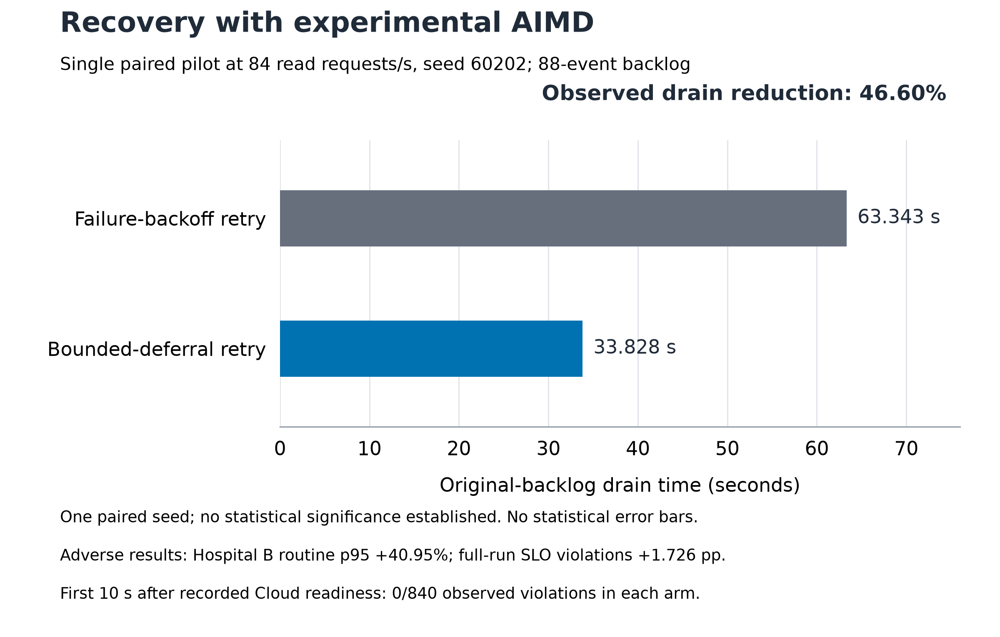

# Reduced H1/H2 evaluation, 1 November 2026

The reduced admission study is complete: **20 selected trials, 20 valid, zero
invalid**, with five paired seeds at each read-load level. AIMD reduced the
measured end-to-end live SLO-violation fraction but substantially increased
recovery time. The full 16-condition/490-trial D2 matrix was intentionally not
executed; its implementation and saved plans remain proposed scope.

## Methods and scope

Two hospitals used identical balanced 88-event maximum-depth3 backlog graphs per
seed (3104-3108), dependency-safe bounded scheduling with inheritance, and
constant-rate or AIMD admission. Load was 36/84 authenticated existing-record
reads per second: 30%/70% of a repeated 120 RPS **provisional read-only reference**,
not maximum sustainable mixed-workload capacity. Trials used one worker, 128 live
request workers, a common 300-second drain timeout, 250 ms live SLO and automatic
reconnection observation. Original backlog IDs define the drain denominator.
The reduced study covers two conditions and one scheduler, not the proposed
factorial or the skewed-case urgent improvement comparison against RR.

Each effect below is the mean of five per-seed AIMD-minus-constant effects:
100*(AIMD/constant-1) for latency/drain; 100*(AIMD fraction-constant fraction)
for SLO percentage points. They are not ratios of pooled means. Routine p95 is
the existing workflow-completion waiting proxy after observed reconnection;
drain uses the observer upper endpoint. Observer intervals, paired bootstrap
intervals and exact sign-flip tests are distinct. All displayed exact two-sided
p-values are **0.0625**; five pairs cannot yield p<.05. No statistically significant
AIMD advantage or recovery-speed improvement is claimed.

End-to-end violations count non-200 responses, transport failures or latency
strictly above 250 ms, once per issued attempt. Successful-read latency and its
violation fraction remain separate in the assessment. There were 86,230 issued
attempts, including 790 non-200/transport failures, and three genuine generator
misses. Neither request failures nor generator misses are relabeled as successes.
The primary 99.9% issuance rule requires exact opportunity-ledger reconciliation
and preserves functional, source, cleanup and container-preservation checks.

## Results and unchanged D3 guardrails

All changes compare **AIMD with constant-rate admission** in this reduced scope;
these do not establish acceptance against other schedulers or across the matrix.
Intervals are 95% paired percentile-bootstrap intervals over five seeds.

| Measure | 30% read load: effect [interval] | 70% read load: effect [interval] | Decision in reduced study |
|---|---|---|---|
| Original backlog drain, % | +278.52 [236.82, 331.66] | +276.34 [214.93, 339.59] | **Failed** <=+20% guardrail at both loads |
| Routine workflow p95, A, % | +607.15 [433.50, 778.34] | +442.53 [304.79, 580.27] | **Failed** <=+20% at both loads |
| Routine workflow p95, B, % | +497.18 [359.31, 622.68] | +369.90 [258.83, 493.26] | **Failed** <=+20% at both loads |
| End-to-end live SLO violations, pp | -2.95 [-3.75, -2.46] | -3.01 [-3.64, -2.37] | **Achieved** <=+1 pp guardrail in the observed study |
| Urgent p95 >=10% better than RR+inheritance | Not established | Not established | **Not established**: no RR arm or preregistered skewed condition in this study |

**Sensitivity:** strict-zero and 99.99% issuance rules retain five pairs at 30%
load; the decisions are unchanged. At 70%, both retain only three pairs: drain
+227.63%, routine A/B +410.02%/+311.35%, SLO -2.51 pp. Their directions remain, but
these stricter analyses are **not established** under the five-pair rule. The
primary 70% decisions therefore depend on the disclosed 99.9% protocol amendment,
which was adopted after initial data. Aggregate accuracy does not establish
identical realized arrivals or bound timing bias; start-lag diagnostics remain
in the assessment.

| Other proposal criterion | Evidence-backed status |
|---|---|
| Zero observed functional correctness violations | **Achieved within recorded checks**, including event-set/content, prerequisite order, completed grants and local ACK state; not a universal proof |
| Complete duplicate-domain-effect/grant-bound coverage | **Not established** across all proposed failure/eligibility scenarios |
| Fairness, shares and retries | Historical finite-prefix/sample measurements retained; sustained fairness guarantees **not established** |
| Isolated scheduler CPU/memory | **Not established**; sampled project resources must not be presented as scheduler-only cost |
| Full D2/D3 acceptance and maximum mixed-workload capacity | **Not established**; intentionally reduced scope and provisional read-only capacity |

## Provenance, replacement and limitations

One compatible corrected AIMD arm at 36 RPS was reused. Its pair is retrospective
and crosses sessions; it was not prospectively randomized with the new constant
arm. Other planned arm orders were deterministically randomized. One constant
84 RPS seed3108 arm was invalid: 2,038 requests versus 2,037 scheduled opportunities
because an issued request tied the stop boundary. The original remains unchanged
and invalid. A single replacement was acquired after serializing stop capture
with dispatch and waiting strictly past due. Its valid original AIMD counterpart
was retained through an explicitly labeled analysis selection. No outcome was
erased or corrected in place; mixed acquisition versions and replacement order
remain limitations. No performance-based trial selection or further tuning occurred.

The study is small, read-only and limited to one backlog shape. It cannot isolate
causes of the observed trade-off or establish a universal admission advantage.
Historical evidence is preserved separately: 280 scheduling trials (12,320 events),
35 DRR service-wall-cost stress trials (1,540 events), 20 exploratory live-load
trials at 24/56 RPS, calibrated-load pilots, and correctness/security/integration
checks. Their source versions, workloads and preservation limitations remain
in their original reports. Earlier screening failures are retained, including
B routine-p95 regressions of +21.39%, +58.96% and +105.33% in three bounded-policy
conditions (five seeds each); they are not promoted to calibrated D3 results.

## Subsequent experimental retry pilot (separate evidence)

An independent seed-60202 pilot at 84 RPS compared failure backoff with explicitly
opted-in bounded admission-deferral retry, both using AIMD and
`pressure-experimental`. Both 88-event trials passed functional/preservation
checks and every generator sensitivity, with zero skips. Drain fell from
**63.343 to 33.828 s (−46.60%)**, but Hospital B routine workflow p95 rose from
24.000 to 33.828 s (+40.95%). Full-run end-to-end SLO violations rose from
99/5,325 (1.859%) to 102/2,845 (3.585%), **+1.726 pp**; the predefined first
10 seconds after each recorded all-Cloud readiness had 0/840 violations in both
arms. Faster drain reduced exposure to successful reads, so denominator effects
must remain explicit; fixed-window zero does not override the full-run result.

This one-seed experimental result supports further investigation, not proposal
acceptance or a general improvement estimate. There is no compatible constant-rate
or RR arm in this pilot. A final-policy matched constant comparison, independent
holdout at both loads and the separate RR urgent comparison remain necessary for
the corresponding claims. Production defaults, original 20-trial results and
figures above remain unchanged; the full D2 matrix remains unexecuted.

Source: `evaluation/results/aimd-deferral-pilot-20261101-202315/`.
See the [detailed diagnosis](../../reports/AIMD_RECOVERY_DIAGNOSIS_20261101.md#independent-bounded-deferral-pilot-seed-60202)
and [verified assessment](../../evidence/aimd-deferral-pilot-review-20261101.json).



Experimental retry figure: [PDF](../../evidence/figures/cp8-aimd-bounded-deferral-pilot-20261101.pdf),
[underlying CSV](../../evidence/figures/cp8-aimd-bounded-deferral-pilot-20261101-data.csv),
[caption with adverse outcomes](../../evidence/figures/cp8-aimd-bounded-deferral-pilot-20261101-caption.md)
and [source/output hashes](../../evidence/figures/cp8-aimd-bounded-deferral-pilot-20261101-provenance.json).
Bars show actual upper observer endpoints, not means across seeds. No statistical
error bars or significance claim is supported by this single pair. Both health
and retry alternatives require explicit experimental opt-in; the default
throughput health policy and failure-backoff retry remain unchanged.
The figure's raw/assessment/CSV hashes and displayed reduction were independently
checked; PNG and rendered PDF were visually inspected. All 47 relevant analysis
tests and `git diff --check` passed without running experiments.

## Evidence and reproduction

### Submission comparison figures

The two figures below show actual paired measurements and separate paired-effect
panels with 95% bootstrap intervals. Connected colors identify the same seed;
diamonds mark arithmetic means, not marginal confidence intervals. Dashed lines
are unchanged guardrails. Drain uses the upper monotonic observer endpoint;
lower observer endpoints are retained in the CSV and are not bootstrap limits.
Arithmetic mean drain times are 31.24 versus
115.88 s at 30% load and 30.55 versus 111.56 s at 70% (constant versus AIMD).
Mean per-trial end-to-end violation rates are 4.024% versus 1.074% and 4.107%
versus 1.095%, respectively; these are not request-pooled rates. Each figure
labels the five seeds, units and provisional read-only capacity reference.

| Comparison | Figures | Underlying data |
|---|---|---|
| Cloud backlog drain | [PNG](../../evidence/figures/cp8-h1-h2-drain-constant-vs-aimd-20261101.png), [PDF](../../evidence/figures/cp8-h1-h2-drain-constant-vs-aimd-20261101.pdf) | [Paired measurements](../../evidence/figures/cp8-h1-h2-drain-constant-vs-aimd-20261101-data.csv), [summary and uncertainty](../../evidence/figures/cp8-h1-h2-drain-constant-vs-aimd-20261101-summary.csv) |
| End-to-end live SLO violations | [PNG](../../evidence/figures/cp8-h1-h2-slo-constant-vs-aimd-20261101.png), [PDF](../../evidence/figures/cp8-h1-h2-slo-constant-vs-aimd-20261101.pdf) | [Paired measurements and outcome counts](../../evidence/figures/cp8-h1-h2-slo-constant-vs-aimd-20261101-data.csv), [summary and uncertainty](../../evidence/figures/cp8-h1-h2-slo-constant-vs-aimd-20261101-summary.csv) |

[Comparison provenance](../../evidence/figures/cp8-h1-h2-comparisons-20261101-provenance.json)
records source and script hashes. PNG and single-page PDF exports were visually
checked; the original invalid trial and previous figures remain unchanged.
Reproduce both comparisons into new paths:

```powershell
.\.venv\Scripts\python.exe -m docs.evidence.plot_h1_h2_absolute_figures_20261101 --output-dir evaluation/results/NEW-comparison-figures
```

### Source assessment and earlier combined figure

The following historical result paths are not included in the tracked source;
local availability may differ. They are retained as provenance, not download links:

- Final assessment: `evaluation/results/replacement-3108-constant-20261101-160903/submission-assessment.json`.
- Original study summaries: `evaluation/results/h1-h2-submission-20261101-151506`.
- Reused corrected block: `evaluation/results/h1-h2-corrected-20261101-143329/ratio1-1_depth3_balanced_load30-seed3104/summary.json`.
- Replacement summary: `evaluation/results/replacement-3108-constant-20261101-160903/summary.json`; analysis-only selection retaining the original AIMD arm: `evaluation/results/replacement-3108-constant-20261101-160903/original-seed3108-analysis-selection.json`.
- Original invalid summary: `evaluation/results/h1-h2-submission-20261101-151506/ratio1-1_depth3_balanced_load70-seed3108/summary.json`; retained [boundary diagnosis](../../evidence/CP8_STOP_BOUNDARY_DIAGNOSIS_20261101.json).
- [Figure](../../evidence/figures/cp8-reduced-admission-final-20261101.png), [paired data](../../evidence/figures/cp8-reduced-admission-final-20261101-pairs.csv), [summary data](../../evidence/figures/cp8-reduced-admission-final-20261101-summary.csv) and [hashed provenance](../../evidence/figures/cp8-reduced-admission-final-20261101-provenance.json). Dots are seed effects; diamonds/bars are mean and paired bootstrap interval. Percentage changes average per-seed ratios, while SLO differences are percentage points. Observer intervals are separate.

The reproduction script reconstructs the assessment from the selected summaries,
checks the original invalid-summary hash and independently recalculates plotted
paired effects from raw summary fields. It tolerates only numerical roundoff
(1e-10 absolute/1e-12 relative) when comparing recalculated floating-point values;
container-resource summation order accounts for a difference at that precision.
Generate artifacts into a new directory; existing evidence is never overwritten:

```powershell
.\.venv\Scripts\python.exe -m docs.evidence.plot_h1_h2_submission_20261101 --output-dir evaluation/results/NEW-final-figures
```

Source summaries/raw archives may be Git-ignored. Preserve the referenced files
and each summary's raw-backup directory separately; a recorded local path is not
an independently verified backup. The CSVs and provenance accompany the report
but do not replace complete raw traces. No experiments were repeated during this
final documentation/figure verification.

Verification: 100 focused evaluation tests passed; the plotted effects and source
selection were independently checked without rerunning experiments.
